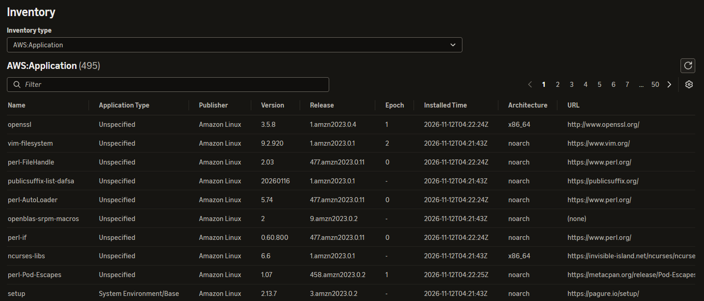
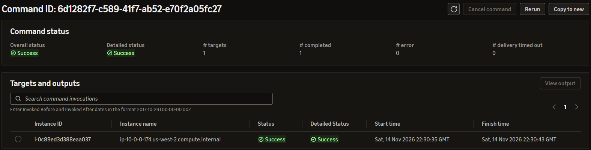
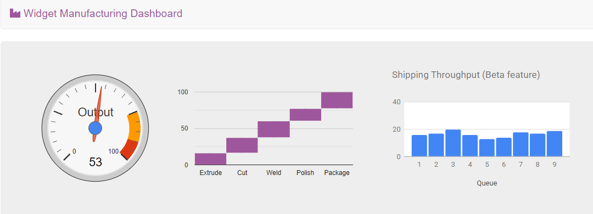
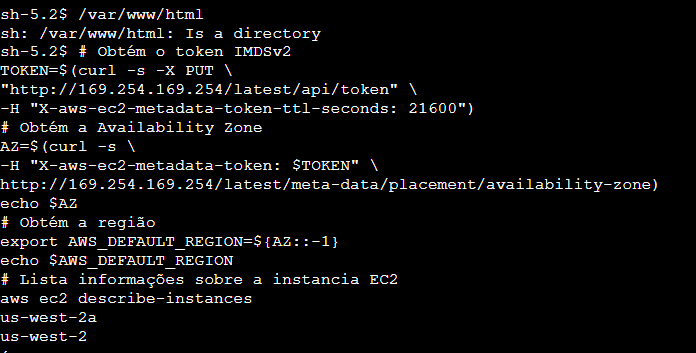

# Lab 6 - Lab 169 - Usando o AWS Systems Manager

## Visão geral

Neste laboratório, explorei o **AWS Systems Manager (SSM)** para administrar uma instância EC2 sem precisar realizar uma conexão SSH tradicional.

Pratiquei o inventário da instância, a execução de comandos remotos, o armazenamento de parâmetros e o acesso ao terminal pelo Session Manager.

## Atividades realizadas

### 1. Fleet Manager - Inventory

Utilizei o Fleet Manager para criar a associação `Inventory-Association` e coletar informações da instância gerenciada.

Consultei o inventário para visualizar informações sobre os aplicativos instalados na instância.

### 2. Run Command

Utilizei o Run Command para executar o documento `Install Dashboard App` na instância gerenciada.

A execução instalou os componentes necessários para disponibilizar o Dashboard de manufatura, sem precisar acessar o servidor por SSH.

Acompanhei a execução até obter o status **Success** e acessei a aplicação pelo endereço IP público da instância.

### 3. Parameter Store

Criei no Parameter Store o parâmetro `/dashboard/show-beta-features`, do tipo String, com o valor `True`.

Esse parâmetro foi utilizado pela aplicação para habilitar um recurso beta do Dashboard, permitindo visualizar um terceiro gráfico.

### 4. Session Manager

Utilizei o Session Manager para abrir uma sessão de terminal diretamente na instância EC2.

Executei comandos para consultar os arquivos da aplicação, identificar informações da região e consultar os dados da instância usando a AWS CLI.

Essa atividade demonstrou como acessar e administrar uma instância sem utilizar chaves SSH ou precisar liberar uma porta de entrada para SSH.

## O que aprendi

- Utilizar o Fleet Manager para consultar informações de instâncias gerenciadas.
- Coletar dados de inventário de uma instância EC2.
- Executar comandos remotamente com o Run Command.
- Utilizar o Parameter Store para armazenar configurações de aplicações.
- Habilitar um recurso da aplicação por meio de um parâmetro.
- Acessar o terminal de uma instância EC2 pelo Session Manager.
- Consultar informações da instância utilizando comandos Linux e AWS CLI.

## Página do projeto

Acesse a página com o resumo visual do laboratório e os flashcards interativos para revisar os principais conceitos:

**[Acessar GitHub Pages](https://brunogacarvalho.github.io/lab-169-using-aws-systems-manager/)**

## Créditos

Laboratório realizado durante a formação em Computação em Nuvem (AWS re/Start) da **Escola da Nuvem**.

- Professor: [Raphael Ohlsen](https://br.linkedin.com/in/raphael-ohlsen)
- Instituição: [Escola da Nuvem](https://escoladanuvem.org/) | [LinkedIn da Escola da Nuvem](https://www.linkedin.com/school/escola-da-nuvem/)

Laboratório realizado como parte da formação em Computação em Nuvem AWS.
